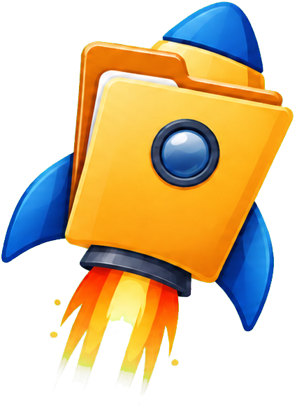

<p align="center">
  
</p>

<h1 align="center">FolderRocket</h1>

<p align="center">
  A local-first workspace for files, projects, and the work around them.
</p>

FolderRocket brings file browsing, file workflows, project workspaces, and optional connected services into one Windows desktop app. Organize local folders, move work through CargoRocket, and keep related files and knowledge together in separate **planets**.

> **Project status:** FolderRocket is an actively developed alpha (`0.2.0-alpha.13`). This repository builds a Windows x64 desktop installer for local use; it is not a public release or an automatic-update channel.

## What you can do

- **Browse and organize files.** Use Folder Management to work with linked folders and files, and Tree Rocket to explore local folder trees and installed applications.
- **Move work through CargoRocket.** Stage files and attachments, then route them into FolderRocket workflows such as folder transfers, notes, reminders, and document tools.
- **Work with documents.** File Studio provides document conversion and related file operations from the workspace.
- **Keep projects separate.** Create planets for different areas of work. Folder selections, integration associations, knowledge, and vault settings are scoped to the selected planet.
- **Build a local planet wiki.** Generate a read-only wiki from the planet’s selected file and folder scope, inspect its source evidence, and view the related graph. Rebuilds are started manually; Obsidian sync uses the last complete wiki revision.
- **Bring in connected services when useful.** Optional Gmail, Outlook, Teams, calendar, and other source panels can be configured for the workflows that need them.
- **Track daily work.** Use Daily Job, reminders, and calendar views to keep deadlines and follow-up work close to the project.

FolderRocket’s desktop app and backend run on your computer. Provider features need their own configuration and an internet connection. Some scheduled workflows can run after you enable them. The app does not bundle personal provider credentials.

## Install or run FolderRocket

### Build the Windows installer

From a Windows checkout with Node.js and npm installed:

```powershell
npm install
Set-Location backend
npm install
Set-Location ..
npm run desktop:package
```

The x64 NSIS installer is written to `%LOCALAPPDATA%\FolderRocket\releases` by default. To choose another output directory for the current PowerShell session:

```powershell
$env:FOLDERROCKET_RELEASE_DIR = 'D:\FolderRocket-Releases'
npm run desktop:package
```

The installer is for local testing and personal use. FolderRocket does not currently publish a public download from this repository.

### Launch from source

To build and open the Electron desktop app with its local backend:

```powershell
npm run desktop
```

For browser development, use two PowerShell terminals. Start the backend from the `backend` directory:

```powershell
Set-Location backend
node server.js
```

Then start the Vite frontend from the repository root:

```powershell
npm run dev
```

## Optional integrations

FolderRocket can run its local file workflows without configuring an AI or mail provider. Connected features need provider credentials and may communicate with those providers when you use them; scheduled workflows can continue while enabled.

- **Browser development:** copy `backend/.env.example` to `backend/.env` and fill in only the providers you intend to configure.
- **Installed desktop app:** provider configuration belongs in `%APPDATA%\FolderRocket\config.env`. See [`desktop/config.env.example`](desktop/config.env.example) for the supported keys.
- **Gmail attachment bridge:** the optional Chrome/Edge extension lets you drag a Gmail attachment into FolderRocket on the same computer. Read the [Gmail Bridge guide](browser-extension/folderrocket-gmail-bridge/README.md).
- **Obsidian Companion:** the optional plugin recognizes a FolderRocket-managed vault and can open its overview, focus the associated planet, or request a sync from the desktop app. See the [Obsidian plugin guide](obsidian-plugin/README.md).

Never commit `.env` files, provider tokens, API keys, personal files, generated work data, or signing keys. Keep real configuration in the local files above; the repository includes only templates.

## Development checks

From the repository root:

```powershell
npm run lint
npm test
npm run build
```

To check backend JavaScript syntax:

```powershell
Set-Location backend
node --check server.js
Set-Location ..
```

The documented workspace helper tests require Node.js 24 or newer:

```powershell
node --test tests/folderDragHover.test.mjs tests/applicationFiles.test.mjs
```

The UI fixtures under `tests/ui/` use synthetic data and mocked network responses. They do not scan or move real files. See [`tests/README.md`](tests/README.md) for how to run them.

## Repository map

| Path | Purpose |
| --- | --- |
| `src/` | React, TypeScript, and Vite frontend |
| `backend/` | Local Node.js and Express API, integrations, and file services |
| `desktop/` | Electron desktop launcher, preload, and configuration templates |
| `browser-extension/` | Optional Gmail attachment bridge |
| `obsidian-plugin/` | Optional FolderRocket Companion for Obsidian |
| `tests/`, `backend/test/` | UI fixtures, helper tests, and backend tests |

## More information

- [Development and release workflow](docs/DEVELOPMENT_AND_RELEASES.md)
- [Graphify source-code map](docs/GRAPHIFY.md)
- [Gmail Bridge setup](browser-extension/folderrocket-gmail-bridge/README.md)
- [Obsidian Companion setup](obsidian-plugin/README.md)
- [Project architecture notes](CODEX.md)
